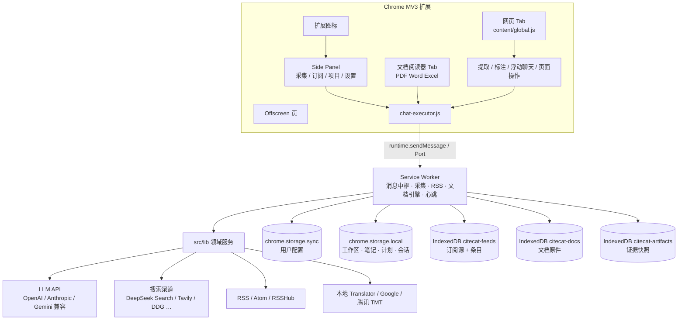
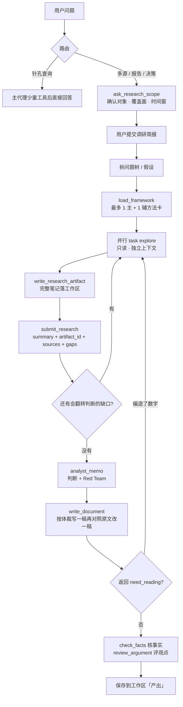
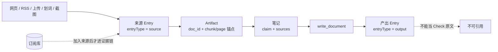

# SuperCat

浏览器侧栏里的 AI 采集、调研与成文助手。

Chrome MV3 扩展。点工具栏图标打开 Side Panel，就能读当前网页、订阅 RSS、派子代理做多源调研、核验引用、写出 Word / Excel，并在扩展内阅读和编辑文档。

> 给后续 AI 协作者的模块地图、消息路由和陷阱清单见 [ARCHITECTURE.md](./ARCHITECTURE.md)。本文是给人看的项目入口。

## 它解决什么问题

把「打开一堆网页 → 复制粘贴 → 让模型写报告」收成一条可核验的链路：

- **原文进工作区**：网页、RSS、上传文件、划词片段都变成带来源身份的 Entry。
- **判断进笔记**：结论必须挂 `doc_id#anchor` 或 URL，不能只活在对话里。
- **交付物进产出**：研报、方案、纪要、表格按体裁写成文档，而不是一长段聊天。
- **事实与判断分层**：事实必须有出处；判断可以超出原文，但必须写依据、反方和证伪条件。禁止「视情况而定」代替结论。

## 核心能力

| 能力 | 做什么 |
|---|---|
| **AI 对话** | Side Panel / 网页浮动窗 / 阅读器三处共用同一套工具执行内核。支持 OpenAI / Anthropic / Gemini 及兼容端点。 |
| **网页采集** | Defuddle + Readability 抽正文；Cloudflare / 验证码不强行绕过，由用户在真实页面过验证后再继续。 |
| **页面操作** | `browser_act` 按视口编号点选填表；`interact_page` 是 CDP / 抓包 / Vision 的逃生口。 |
| **RSS / Webfeed** | 订阅 RSS/Atom/OPML，RSSHub 多实例回退；也可从当前网页可视化创建订阅源。定时刷新、星标、加入来源。 |
| **Deep Research** | 先确认范围，再并行派 `explore` 读原文；Analyst 写备忘与 Red Team，Writer 按体裁成文，最后事实核验 + 观点评审。 |
| **工作区** | 每个项目三主干：**来源 / 笔记 / 产出**。聊天清空不影响这三份资产。 |
| **文档阅读与编辑** | 接管 PDF / Word / Excel / CSV / Markdown。docx / xlsx 由 Service Worker 无头改原件，不必让用户点「编辑」。 |
| **心跳任务** | 按 once / interval / daily / weekly / cron 到期后后台执行，不依赖侧栏是否打开。 |
| **对话出图** | `plot_chart` 用 G2 在气泡里画柱/线/面积/散点/热力等；需要进 Word 时光栅化成 PNG 嵌入。 |

## 界面

底部四个标签：

1. **采集** — 左列 AI 对话，右列当前项目工作区（可收起，也可切到整页）。
2. **订阅** — 订阅源列表 + 条目流；支持搜索、星标、批量加入来源。
3. **项目** — 多项目切换与管理。每个项目有独立的来源、笔记、产出、心跳和对话。
4. **设置** — AI 渠道、搜索渠道、翻译、记忆、主题与清空。

网页上还有：圆形勾选、检视模式、划词标注、片段收藏、浮动聊天窗。PDF / Office 直链会改写到 SuperCat 阅读器，避免落到浏览器内置 viewer（content script 进不去）。

## 快速开始

需要 Node.js 18+、Chrome 138+（本地 Translator API、Side Panel、Offscreen 都按较新 Chrome 写的）。

```bash
npm install
npm run build
```

然后：

1. 打开 `chrome://extensions`
2. 打开「开发者模式」
3. 「加载已解压的扩展程序」，选仓库里的 `dist/`
4. 点工具栏 SuperCat 图标打开侧栏
5. 到「设置」加一条 AI 渠道（DeepSeek / 智谱 / OpenAI / Claude / Gemini / 本地 Ollama 等）

改源码后必须重新 `npm run build`，再在扩展页点「重新加载」。只改 Side Panel UI 也要 build；改 Service Worker 后必须重新加载扩展，否则还在跑旧 SW。

开发时可用：

```bash
npm run dev          # 等价于 build，并提示去加载 dist/
npm test             # 冒烟测试套件
```

## 架构



消息总线是 `src/background/service-worker.js` 里的 `switch (message.type)`。新功能先在这里加 `case`，再让 panel / content / reader 发对应消息。工具执行不全走 SW：读当前页、搜索、画图、通用 `call_api` 等在 `chat-executor.js` 里直接跑；RSS 和采集类才 `sendMessage` 到后台。

构建入口是 `build.js`（Vite 多入口）。产物在 `dist/`，Chrome 加载的也是这个目录。Service Worker 产物会剥掉 Vite 注入的 `__vitePreload`（里面用了 `window`，SW 里会崩）。pdfjs / Univer / mammoth 等重依赖走动态 `import()`，按需进 `dist/chunks/`。

## Deep Research 主流程

普通问题和深度调研走不同预算。针孔查询（总结当前页、一次搜索、整理已有材料）直接回答；多源、多维度、长报告、决策建议会升级为 Deep Research。



角色分工：

| 角色 | 职责 | 完成条件 |
|---|---|---|
| **Main** | 拆问题、派工、综合、成文。不把多源全文读进主对话。 | 用户要文档时，`write_document` 已保存 |
| **explore** | 只读调研。交判断、关键数字、对不上的地方；原文留在 `passages`。 | 必须 `submit_research`，自然语言不算交回 |
| **general** | 可写支线：搜索 + 入库 / 改文档 | 同上 |
| **browser** | 真实标签页上点选、填表、翻页、过反爬 | 同上 |
| **section_job** | Sub 专属无状态章节阅读，每次新短上下文，只读一个 `doc_id#anchor` | `submit_report` |
| **Check** | 引文逐字匹配、蕴含、跨信源独立性。核验身份由运行时产生 | 失败项交回 Main，通过项不重复堆上下文 |

内置分析框架大约 26 个（问题树、五力、利润池、DCF、ACH、PESTEL、商业模式画布等）。简单任务用 `no_framework`；目录对不上时用 `custom` 并写具体方法名。禁止把 SWOT / PEST / 五力一次性全套上。

## 工作区与证据链



约束：

- 原文不进对话，进的是地址。回读用 `read_section(doc_id, chunk/page/offset)`，不要重新开页面。
- `ingest` 只接受已有 Entry 或标签页，禁止拿一段裸文本伪装来源。
- 只有 `trustClass = source` 的 artifact 可被引用。产出、代码执行结果、模型生成文本都是 derived。
- RSS 是独立候选池；点「加入来源」或 `collect_feed_items` 之后才进入证据链。
- 笔记的 `sources` 必填。来源被删后，已 verified 的笔记会降为 open。

## 数据存在哪

| 位置 | 存什么 |
|---|---|
| `chrome.storage.sync` | API 渠道以外的用户配置、黑名单、当前项目 id |
| `chrome.storage.local` | 工作区 Entry、笔记、任务清单、聊天会话、心跳、AI 记忆、标注、搜索渠道密钥 |
| IndexedDB `citecat-feeds` | RSS 订阅源与条目，含 2-gram 倒排 |
| IndexedDB `citecat-docs` | PDF / Word / Excel 等原始二进制，按 docId 存 |
| IndexedDB `citecat-artifacts` | 可按 `doc_id#anchor` 回读的来源快照与 provenance |

项目之间用 `entries_{projectId}` 这类带后缀的 key 隔离。删项目会级联清 Entry、artifact、原件、标注和该项目心跳，但保留 AI 记忆与 RSS。

## 工具一览

主代理大约 40 个工具，按层使用：

| 层 | 触发 | 主要工具 |
|---|---|---|
| 工作区 | 「来源 / 产出 / 这条」 | `fetch_entry` `update_entry` `search_workspace` `notebook` |
| RSS | 「订阅 / 信源 / 我订的」 | `list_feeds` `query_feed_items` `refresh_feeds` `collect_feed_items` |
| 当前页 | 「这页 / 总结这个 / 点一下」 | `read_current_page` `browser_act` |
| 互联网 | 「网上搜 / 最新」 | `search_web`；多源则 `task(explore)` |
| 成文 | 「写一份研报 / 方案 / 纪要」 | `write_document`；已有表格用 `create_document` |
| 文档手术 | 「改这段 / 加一列」 | `doc_edit` / `doc_review` |
| 定时 | 「每天 / 每隔 / 闹钟」 | `manage_heartbeat` |
| 外部 API | 「拉 FRED / 打这个 REST」 | `call_api` |

父级专属（子代理不能调）：`notebook` `plan` `plot_chart` `place_images` `save_memory` `write_document` `ask_research_scope` 等。explore 不能点击、入库、改文档。

## 接入

设置页可同时保存多条 AI 渠道，对话输入栏随时切换。协议三选一：

- **openai** — OpenAI、DeepSeek、智谱、Qwen、Kimi、豆包、OpenRouter、SiliconFlow、Grok、Ollama
- **anthropic** — Claude 官方及兼容 Messages 的端点
- **gemini** — Gemini 原生 `generateContent`

搜索渠道独立于对话渠道，可选 DeepSeek Search API（默认带正文）、Tavily、Brave、Serper、Exa、博查、SearXNG 或网页抓取。DeepSeek 官方搜索走 `POST /v1/tools/search`。

翻译有三层：Chrome 内置 Translator → Google 免 Key 端点 → 腾讯云 TMT，失败逐级回退。

## 源码地图

```
src/
  background/service-worker.js   消息中枢、采集、RSS、心跳、无头文档引擎
  content/global.js              页面提取、标注、浮动聊天、browser_act
  sidepanel/                     Side Panel：对话、工作区、订阅、设置
  reader/                        PDF / Word / Excel 阅读器
  offscreen/                     需要 DOM 但不想开标签的后台页
  lib/                           领域服务（提取、AI、工具、Check、存储）
    providers/                   三协议适配，全部对话流量的唯一出口
    check/                       引文 / 蕴含 / 独立性核验
    tools.js                     工具 schema
    chat-executor.js             工具执行内核（三宿主共享）
test/                            Node 冒烟测试（不启动 Chrome）
dist/                            构建产物，Chrome 加载这个目录
```

常见改动落点：

| 想改什么 | 先看 |
|---|---|
| 新工具 | `tools.js` → `chat-executor.js` 的 `case` → `chat-prompt.js` 使用规则 |
| 新消息类型 | `service-worker.js` 的 `switch` |
| 提示词 | `sidepanel/chat-prompt.js`，改完 bump `PROMPT_PROTOCOL_VERSION` |
| 子代理工种 / 白名单 | `subagent-core.js` / `subagent-policy.js` |
| 存储字段 | `storage.js` / `source-model.js`，读时给默认值 |
| UI | `sidepanel/` 或 `reader/`，保持原生 DOM，不要上前端框架 |

更细的模块表、消息清单和已知陷阱以 [ARCHITECTURE.md](./ARCHITECTURE.md) 为准。改了 `src/*` 应同步改那份文档对应章节。

## 许可

[Apache License 2.0](./LICENSE)
